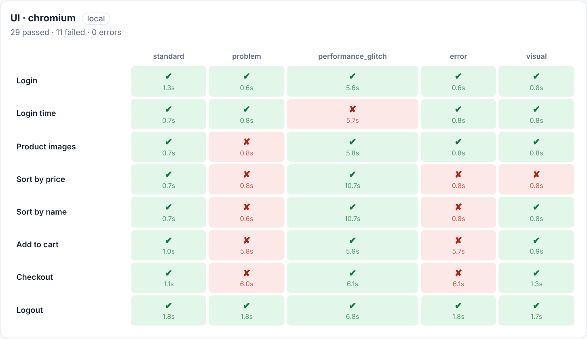

# QA Automation Demo: Playwright + Pytest

End-to-end UI and API test suite built with **Python, Playwright and Pytest**,
run every night in CI, with results delivered as **matrices** (tests × variants)
in HTML, in the GitHub job summary and on **Slack**.

It covers two public demo applications and three database engines:

| Target | Type | What is tested |
|---|---|---|
| [Swag Labs (saucedemo)](https://www.saucedemo.com) | Web shop | Login, catalog, sorting, cart, checkout, logout |
| [Restful-booker](https://restful-booker.herokuapp.com) | REST API | Auth, create / read / search / update / delete bookings |
| PostgreSQL 14–17, MySQL 8.0 / 8.4, MongoDB 6.0–8.0 | Databases | Create database and tables, insert rows, filter / join / aggregation queries, update, transaction rollback, unique constraint, drop |



## Approach

This project reproduces, on public applications, the approach I used to test a
product before and after each customer installation.

**Two run modes**

- `local`: both applications are **installed from their source code in Docker**
  (`docker compose`) and tested on `localhost`, the way a release is validated
  on a customer machine before going live.
- `remote`: the same suite runs against the **hosted** applications.

**Results as matrices.** Each test is a *row*; each variant of the system
under test is a *column*; there is one matrix per suite and browser.

| Matrix | Rows | Columns |
|---|---|---|
| UI · chromium / firefox | Login, login time, product images, sorting, cart, checkout, logout | saucedemo user profiles: `standard`, `problem`, `performance_glitch`, `error`, `visual` |
| API · restful-booker | Create, read, search, full update, partial update, delete | booking datasets: `standard`, `no_deposit`, `unicode_name`, `long_stay` |
| DB · postgres / mysql / mongo | Connection, create database, create tables, insert rows, queries (filter, join, aggregation), update, transaction rollback, unique constraint, drop database | server versions: `14`, `15`, `16`, `17` / `8.0`, `8.4` / `6.0`, `7.0`, `8.0` |

**Database tests.** The same scenario runs on every engine and version
through one adapter per engine (`databases/adapters.py`); on MongoDB,
collections play the role of tables and `$lookup` the role of `JOIN`. A
deterministic dataset (1,000 customers, 3,000 orders) is loaded into a fresh
database for each test, and every query result is compared with the value
computed in Python from the same rows, rather than with hard-coded numbers.
The first row also checks that each server really runs the version of its
column. The database servers always run locally in Docker, so this suite is
skipped in `remote` mode.

A bug that only affects one variant shows up as a single red cell, instead of
hiding behind a green "happy path". The saucedemo profiles other than
`standard_user` **deliberately simulate bugs** (broken images, wrong sorting,
slow login, failing checkout): the red cells in the example above are the suite
catching them. Tests that do not depend on a variant (rejected login, ping,
missing token...) are reported as *standalone checks*.

**Nightly runs.** A scheduled GitHub Actions workflow runs both modes on
Chromium and Firefox every night, merges the results into the matrices, posts
them to Slack and stores the HTML report and Playwright traces as artifacts.

## Project structure

```
pages/                Page objects for saucedemo (selectors via data-test attributes)
api/                  restful-booker client and booking datasets
tests/ui/             UI tests (one run per user profile)
tests/api/            API tests (one run per dataset)
databases/            Server versions, dataset with expected results, one adapter per engine
tests/db/             Database tests (one run per server version)
reporting/
  pytest_plugin.py    Records each test as a matrix cell (one JSON file per run)
  build_report.py     Merges runs into HTML / Markdown matrices
  slack.py            Posts the matrices to Slack via an incoming webhook
docker/               Dockerfiles that install both apps from source, plus the test runner
docker-compose.yml    Local mode: apps + optional containerized test run
scripts/run_suite.sh  Run the suite and build the report
.github/workflows/    Nightly CI (cron) + Slack notification
```

## Running the tests

Requirements: Python 3.11+, and Docker for the local mode.

```bash
pip install -r requirements.txt
python -m playwright install chromium firefox
```

**Local mode** (applications installed in Docker):

```bash
docker compose up -d --build --wait saucedemo restful-booker
./scripts/run_suite.sh                      # QA_MODE=local is the default
```

**Database tests** (9 servers in Docker; a server that is not running is
reported as skipped):

```bash
docker compose --profile databases up -d --wait
./scripts/run_suite.sh tests/db
DB_TARGETS=postgres:16,mysql ./scripts/run_suite.sh tests/db   # a subset
```

Or run everything, tests included, in containers:

```bash
docker compose --profile tests run --rm tests
```

**Remote mode** (hosted applications):

```bash
QA_MODE=remote ./scripts/run_suite.sh
```

Useful options:

```bash
BROWSERS="chromium firefox" ./scripts/run_suite.sh   # several browsers
./scripts/run_suite.sh tests/api                       # API only
./scripts/run_suite.sh -k checkout --headed            # any pytest option
```

The report is written to `reports/matrix.html` and `reports/matrix.md`.

## Slack notifications

Create a Slack [incoming webhook](https://api.slack.com/messaging/webhooks),
then either export it locally (`export SLACK_WEBHOOK_URL=...`) or add it as the
`SLACK_WEBHOOK_URL` secret of the GitHub repository. Without a webhook, the
message is printed instead of sent.

## Design choices

- **Page Object Model**: tests describe behaviour; selectors live in `pages/`
  and rely on `data-test` attributes, which survive styling changes.
- **Parametrized fixtures**: the `user` and `dataset` fixtures turn one test
  into one cell per variant, without duplicating code.
- **Isolated tests**: each UI test gets a fresh browser context; each API test
  creates its own booking and deletes it afterwards; each database test works
  in its own randomly named database, dropped at the end.
- **Test oracle**: database query results are checked against values computed
  independently from the inserted data.
- **Report separate from execution**: each run writes JSON; the report step
  merges any number of runs (modes, browsers, CI jobs) into the same matrices.
- **Expected failures stay visible**: the nightly job does not hide the
  simulated bugs; it reports them, as a real nightly run would report regressions.
